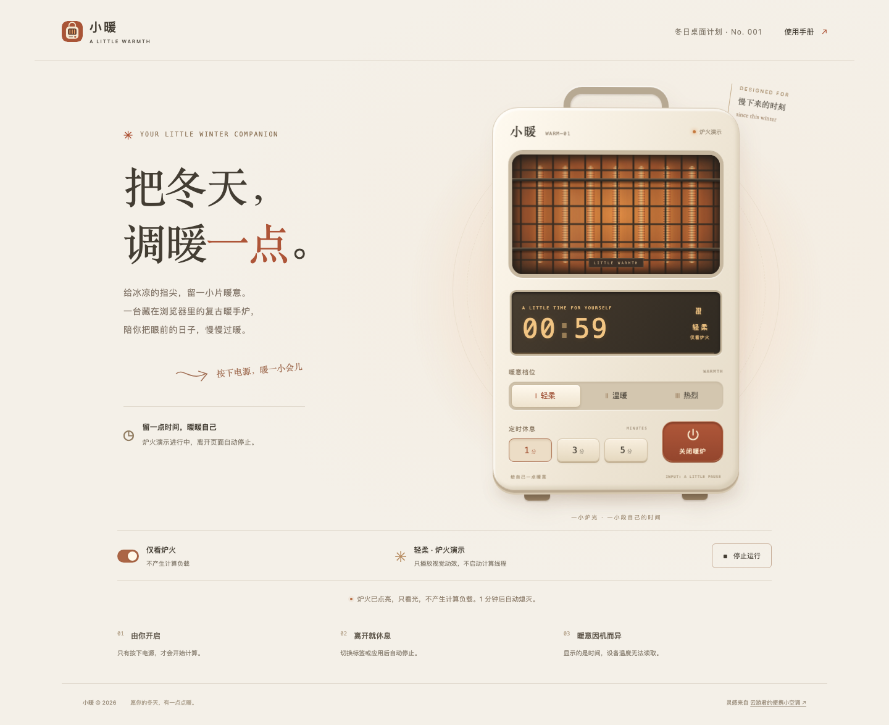
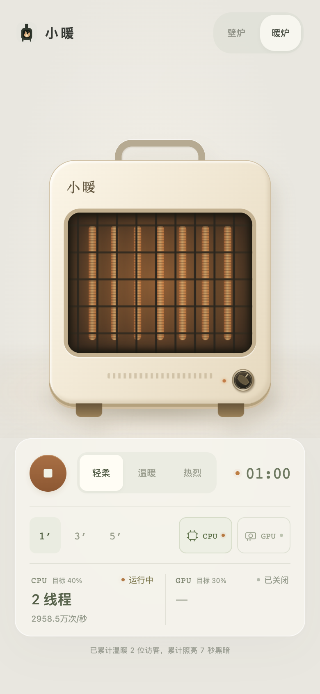

<p align="center"></p>
<h1 align="center">小暖</h1>
<p align="center"><a href="https://warm.gongfpp.icu/">打开使用</a></p>

浏览器里的壁炉，支持 CPU、GPU 加热和纯炉火展示，可切换北欧壁炉与复古暖炉两种皮肤。



## 使用

1. 选择轻柔、温暖或热烈，以及 1、3 或 5 分钟。
2. 按电源开启，再按一次停止。
3. 按需开启 CPU、GPU；两者都关闭时只显示炉火。
4. 左上角为首页，右上角可切换皮肤，`?` 中查看说明。

页面隐藏或到点时停止，返回后不会自动重启。网页保持可见时切换到其他窗口会继续运行，可以与活动监视器并排查看。修改定时会重新计时，切换档位保留剩余时间。

CPU 线程和 GPU 工作量会根据本机能力与运行响应自动调整；检测信息只在本页使用。

暖手模式会增加耗电；实际发热取决于设备和散热，网页无法读取机身温度。设备明显发烫或不适时请停止，不要遮挡散热口。

GPU 需要浏览器支持 WebGL2、OffscreenCanvas 并开启硬件加速；检测到软件渲染或不可用时会提示，不会把 CPU 软件渲染冒充 GPU 加热。

<details><summary>手机版截图</summary>



</details>

## 本地运行

安装 Node.js 18 或更新版本后，在项目目录执行：

```sh
npm start
```

打开 `http://127.0.0.1:4173`，无需安装运行依赖。不要直接双击 HTML 文件。

`npm run build` 生成可托管的 `dist/`。更多信息：[部署说明](docs/deployment.md) · [开发说明](docs/development.md) · [MIT License](LICENSE)。
