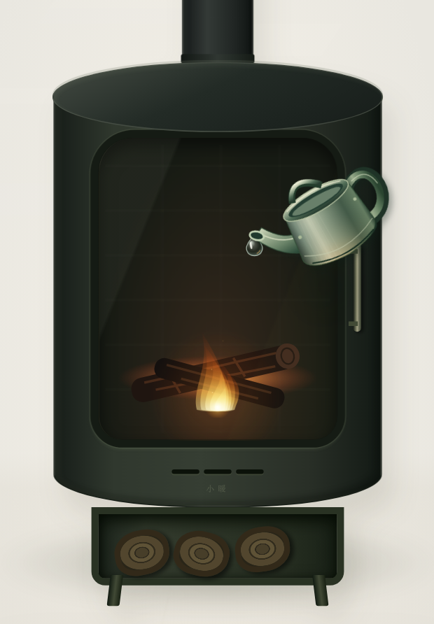

<p align="center"></p>
<h1 align="center">小暖</h1>
<p align="center"><a href="https://warm.gongfpp.icu/">打开使用</a></p>

浏览器里的壁炉，支持 CPU、GPU 加热和纯炉火展示，可切换北欧壁炉与复古暖炉两种皮肤。


## 使用

1. 选择轻柔、温暖或热烈，以及 1、3 或 5 分钟。
2. 按电源开启，同时播放模拟炉火声；再按一次立即停止计算，并播放当前设备的收尾动作。
3. 按需开启 CPU、GPU；两者都关闭时只显示炉火。
4. 右上角可切换壁炉与暖炉皮肤。

页面隐藏或到点时停止，返回后不会自动重启。网页保持可见时切换到其他窗口会继续运行，可以与活动监视器并排查看。修改定时会重新计时，切换档位保留剩余时间。

控制区的「目标」随档位变化，表示计算与休息的调度比例。CPU 按每线程计算，不能将这些数字当作整机使用率，也不承诺整机占用上限。线程和工作量会根据本机能力与运行响应自动调整；检测信息只在本页使用。

| 档位 | CPU 目标 | GPU 目标 |
| --- | --- | --- |
| 轻柔 | 40% | 30% |
| 温暖 | 82% | 60% |
| 热烈 | 85% | 85% |

控制区分别显示 CPU、GPU 的真实运行状态。CPU 显示活动线程与算术循环次数/秒，GPU 显示完成批次/秒，硬件计时可用时显示 GPU 毫秒/批。切换设置后收到新版本的计算数据才确认运行，数据过期会清空，不显示使用率估算。

停止或到点时，壁炉用金属水壶浇灭炉火，残余火苗重新冒头，再补最后一滴；电暖炉则旋钮断电、电热丝渐暗，单根电热丝偷偷回亮一次后再次被关掉。电暖炉没有浇水或蒸汽。

收尾约 2.7 秒，过程中可以直接重新点火；计算从动作开始前就已停止。减少动态效果时直接关闭。

声音随电源启停，壁炉收尾配合短促水声，电暖炉配合机械开关声，无需单独操作。页面隐藏或离开时立即停声，返回后不会自动播放。浏览器不支持或阻止音频时，其他功能仍可使用。

页脚用一行灰字显示「已累计温暖 xx 位访客，累计照亮 xx 秒黑暗」。访客在主动开启后才计入，同一浏览器重复开启不会重复计人；时长累计实际点亮的时间，包含纯炉火展示，熄火动画不计入。累计从该功能上线开始，没有补写历史数字。

统计只上传随机浏览器标识、每次开启的随机标识和累计点亮毫秒数，不上传硬件信息、位置或浏览记录。清除网站数据或换浏览器会被视为新访客，人数不等于严格去重的自然人。数据保存在腾讯云 EdgeOne；统计不可用时隐藏该行，其余功能照常使用。

暖手模式会增加耗电；实际发热取决于设备和散热，网页无法读取机身温度。设备明显发烫或不适时请停止，不要遮挡散热口。

手机、平板和电脑均可打开，无需安装。开启时自动检测 CPU / GPU 能力：后台 GPU 不可用时尝试兼容模式，GPU 仍不可用时改用 CPU；均不可用时只展示炉火。不可用的开关会变灰，不使用 CPU 软件渲染冒充 GPU。

iOS、安卓、鸿蒙按浏览器实际能力选择，不依赖系统名称放行。已完成 WebKit / Chromium 手机视口及故障降级检查，尚未完成三类系统的真机验收。

<details><summary>手机版截图</summary>


</details>

<details><summary>壁炉熄火细节</summary>



</details>

## 本地运行

安装 Node.js 18 或更新版本后，在项目目录执行：

```sh
npm ci
npm start
```

打开 `http://127.0.0.1:4173`。不要直接双击 HTML 文件。本地默认只运行网页，累计统计需部署 EdgeOne 函数；开发验证可使用部署说明中的临时本地统计服务。

`npm run build` 生成可托管的 `dist/`。更多信息：[部署说明](docs/deployment.md) · [开发说明](docs/development.md) · [MIT License](LICENSE)。
